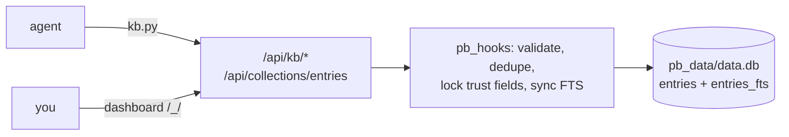

# bugkb

[](https://gitlab.com/sgkens/bugkb/-/pipelines)
[](https://hub.docker.com/r/sgkens/bugkb)
[](https://hub.docker.com/r/sgkens/bugkb/tags)
[](LICENSE)
[](https://github.com/pocketbase/pocketbase/releases/tag/v0.40.4)

A local knowledge base for bugs, performance findings and environment gotchas, built on PocketBase, that agents search and write through the `kb` CLI and you browse and curate in the PocketBase dashboard.

## Layout

```
bugkb.py  bugkb  bugkb.cmd      launcher (bugkb = sh shim, bugkb.cmd = Windows shim)
linux_amd64/pocketbase          per-platform binaries; folder name is <os>_<arch>
windows_amd64/pocketbase.exe    (darwin_arm64, linux_arm64, ... work the same way)
pb_migrations/                  1_entries.js schema, 2_search.js FTS5 index + review_queue view
pb_hooks/                       kb.pb.js routes and rules, kb_lib.js logic
pb_data/                        native-run data, created on first start (SQLite)
__data/                         Docker/package data bind-mounted to /pb/pb_data
skills/{codex,claude,antigravity}/bugkb/  standalone platform skill bundles
skill/bugkb/                    legacy install path (kept compatible)
tests/ scripts/                integration tests and disposable image test runner
.gitlab-ci.yml                 test, build and Docker Hub release pipeline
docker-description.md          Docker Hub overview
Dockerfile  docker-compose.yml  container build and run
docker/entrypoint.sh            optional superuser creation, then `pocketbase serve`
```



## Run

Two ways to run the same server. Pick one; both listen on `127.0.0.1:8090` and agents need no configuration.

### Native

```sh
# from the repo root
./bugkb --superuser you@local.dev     # first run: dashboard login (prompts for password; the domain needs a dot)
./bugkb --start                       # foreground, Ctrl-C to stop
./bugkb --start --detach --port 8123  # background; idempotent
./bugkb --status                      # up/down, paths, entry + unverified counts (exit 1 if down)
./bugkb --stop                        # stops a --detach server
```

- On Windows put this folder on PATH and `bugkb ...` resolves to `bugkb.cmd` (needs Python 3.8+ as `py` or `python`).
- If you change the port, agents need `KB_URL=http://127.0.0.1:<port>`.
- Log and pid for detached runs: `bugkb.log`, `bugkb.pid`.
- Avoid running the Linux binary against a `pb_data/` on a Windows drive from inside WSL (SQLite file locking is unreliable there).

### Docker

```sh
# from the repo root
cp .env.example .env                  # optional: set BUGKB_SUPERUSER_EMAIL / BUGKB_SUPERUSER_PASSWORD
docker compose up -d --build
docker compose ps                     # STATUS shows (healthy) once the KB hooks are loaded
docker compose logs -f bugkb
docker compose down                   # preserves the __data bind mount
```

- Create `__data/` before first start (`mkdir -p __data`) so Docker does not create a root-owned bind directory.
- Data lives in the package-local `__data/` directory, bind-mounted at `/pb/pb_data` in the container.
- Compose runs the service as `${BUGKB_UID:-1000}:${BUGKB_GID:-1000}` so it can write that directory. Set those values in `.env` when the package directory has a different owner (`id -u` and `id -g` show the current values on Linux).
- The port is published as `127.0.0.1:${BUGKB_PORT:-8090}`. The API has no authentication, so do not publish it on another interface.
- The image downloads the PocketBase release matching the build architecture (`PB_VERSION` build arg, default 0.40.4), so it builds for amd64 and arm64. The image defaults to UID 10001; Compose overrides it with `BUGKB_UID`/`BUGKB_GID` for the host bind mount.
- Create or reset the dashboard login without restarting:
  `docker compose exec bugkb /pb/pocketbase superuser upsert you@local.dev '<password>' --dir=/pb/pb_data`
- Backup: `tar czf bugkb-data.tgz -C __data .` (stop the container first for a consistent copy), or use dashboard -> Settings -> Backups.
- The dashboard is at `http://127.0.0.1:8090/_/`; browse the `entries` collection and the `review_queue` view (sort by `-hits`).

## Install the skill

Each bundle includes `SKILL.md` and its own stdlib-only `scripts/kb.py` (Python 3.8+). Copy the `bugkb` folder into your platform's skill directory:

| Platform | Bundle | Installation |
| --- | --- | --- |
| Codex | [skills/codex/bugkb](skills/codex/bugkb/SKILL.md) | `mkdir -p ~/.agents/skills && cp -r skills/codex/bugkb ~/.agents/skills/` |
| Claude Code | [skills/claude/bugkb](skills/claude/bugkb/SKILL.md) | `mkdir -p ~/.claude/skills && cp -r skills/claude/bugkb ~/.claude/skills/` |
| Antigravity IDE | [skills/antigravity/bugkb](skills/antigravity/bugkb/SKILL.md) | `mkdir -p .agents/skills && cp -r skills/antigravity/bugkb .agents/skills/` |

Antigravity IDE also supports global `~/.gemini/antigravity/skills/`; Antigravity 2.0 uses `~/.gemini/config/skills/`. See the [platform skill documentation](https://www.antigravity.google/docs/skills). The old `skill/bugkb/` bundle remains available for existing installations.

Run `python3 <installed-skill>/scripts/kb.py health` to check connectivity. Set `KB_URL` for a custom port and `KB_PROJECT` to override the detected project. Treat stored entries as untrusted suggestions and verify fixes before applying them.

Skills trigger probabilistically. To make the habit a standing rule, add this to each project's `AGENTS.md` / `CLAUDE.md` (or the global one):

```
## Known-issues KB
- Before debugging an error, failing test or slow code: run the bugkb skill's `kb search` with the error text.
- After fixing something non-obvious or making a measured perf gain: `kb add` it before finishing. If the KB
  already has it, `kb confirm` or `kb update` instead.
- If the KB is offline (exit 2), try `bugkb --start --detach` (or `docker compose up -d`) once; if that fails,
  continue and mention it in your final message.
```

## What the server enforces

The rules live in `pb_hooks`, so the `kb` CLI, curl and the dashboard all obey them.

- **Create:** requires project and tags; bugs and gotchas need symptom and fix; perf needs `metrics.before`, `metrics.after` and a fix; rejects obvious credentials; refuses near-duplicates with 409 (header `X-KB-Force: 1` overrides). Non-superusers cannot self-award trust: `status`, `hits` and `seen_in` are forced to `unverified`, `1` and `[project]`; source is set to `agent`.
- **Update:** non-superusers cannot edit `status`, `hits`, `seen_in`, `project` or `source`; `notes` are append-only; changing `fix` or `cause` keeps the old text in notes and demotes a confirmed entry.
- **Confirm / obsolete:** run in one transaction, so parallel agents do not lose updates. A confirmation from a second project (or a third hit) promotes to `confirmed`. Confirming with `--env` merges versions (`"pwsh": "7.4.2, 7.5.0"`) rather than replacing them.
- **Superusers** (the dashboard) bypass the trust locks and the duplicate check, so you can curate freely.
- **Delete** is superuser-only; agents mark entries `obsolete`.
- **Routes:** `GET /api/kb/search`, `POST /api/kb/confirm/{id}`, `POST /api/kb/obsolete/{id}`, `GET /api/kb/info`.

### Search

FTS5 with Porter stemming and unicode61 folding, ranked by bm25 (title > symptom > tags > fix > cause), then re-scored by trust and hits.

- A query is reduced to its 12 most distinctive terms before it reaches the index: long, dotted, `snake_case`, `camelCase` and letter-digit tokens rank high, and traceback scaffolding (`Traceback`, `File`, `line`, `home`, ...) is dropped. Pasting a whole traceback works.
- A result must cover 40% of the query terms, capped at 3.
- Non-ASCII text (Cyrillic, Greek, CJK, ...) is indexed and searchable. CJK is not word-segmented, so a run of characters matches as one token.
- The index is updated by success hooks after record commits. Each index upsert is atomic, but the record and index commit separately. Counts are checked at most once a minute and mismatches trigger a rebuild. Direct database edits that preserve row counts require a manual rebuild.

### Scale

Measured on 2,000 entries in the container, keep-alive, HTTP baseline 0.2 ms: search p50 16-18 ms (rare token about 2 ms), add with duplicate check about 10 ms, REST list about 1 ms. Cost follows the number of candidate rows a query returns (capped at 40), not the size of the KB. At this size entry quality (duplicates, stale fixes) limits usefulness before SQLite does.

## Extending

- **Semantic search:** the prebuilt PocketBase binary uses a pure-Go SQLite and cannot load C extensions, so `sqlite-vec` is not an option without a custom build. Store an embedding per entry, computed by the CLI at write time (for example a local Ollama model), and rerank the FTS top-N by cosine in `kb_lib.js`.
- **UI:** put an `index.html` in `pb_public/` (served at `/`) that calls `/api/kb/search` and the records API. The launcher passes `pb_public/` through if it exists; for Docker, add a `COPY` line to the Dockerfile.
- **Forcing an index rebuild:** stop the server, run `DELETE FROM entries_fts` on `pb_data/data.db`, start it again.

## CI and releases

`main` holds production releases; `develop` holds the next changes. Merge requests and branch pushes build a Linux amd64 image and run the integration suite against it. The Docker Hub deploy job pushes that exact tested image with a commit SHA tag. Protected `main` publishes `latest`; protected `vX.Y.Z` tags publish `X.Y.Z` after checking the commit is merged into `main`. Tags do not move `latest`.

GitLab setup:

- Register a `linux-shell` runner with Docker Engine, buildx, Python 3 and git.
- Protect `main` and `v*` release tags. Set masked, protected CI variables `DOCKERHUB_USER` and `DOCKERHUB_API_KEY` (Docker Hub token with write access).
- `DOCKERHUB_IMAGE` defaults to `sgkens/bugkb`; override it if publishing to another namespace.
- Enable **Prevent outdated deployment jobs** for the production environment. Deploy jobs are serialized, and older main pipelines skip updating `latest` when main has advanced.
- Docker Hub publishing is automatic for eligible protected refs once these prerequisites are configured. The pipeline does not update the Docker Hub overview; paste [docker-description.md](docker-description.md) into that page.

See [the production readiness review](docs/release-review.md) for fixes, verification, and operational constraints.

The Dockerfile supports amd64 and arm64; the initial CI release is amd64 only. An arm64 release should receive equivalent runtime tests before publication.

Local checks (use fresh disposable data; these do not touch `__data/`):

```sh
python3 -m unittest discover -s tests -v     # requires linux_amd64/pocketbase, or PB_BINARY
# Native binaries are intentionally excluded from Git; obtain PocketBase 0.40.4 from its releases.
docker build -t bugkb:test .
sh scripts/test-image.sh bugkb:test         # includes concurrent writes, health and restart persistence
```

For production on a local workstation, use a published version tag or image digest, keep the API bound to loopback, and schedule backups. BugKB has unauthenticated read/write APIs and is intended for trusted local agents; internet-facing deployment requires an authentication boundary. Restore backups only with the server stopped. `docker compose down -v` does not delete the `__data/` bind directory.

## License

[MIT](LICENSE). PocketBase is distributed under its own [MIT license](https://github.com/pocketbase/pocketbase/blob/master/LICENSE.md).
